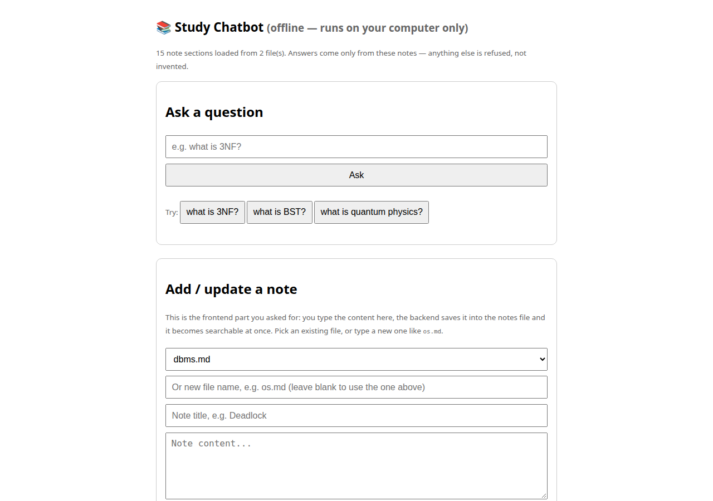
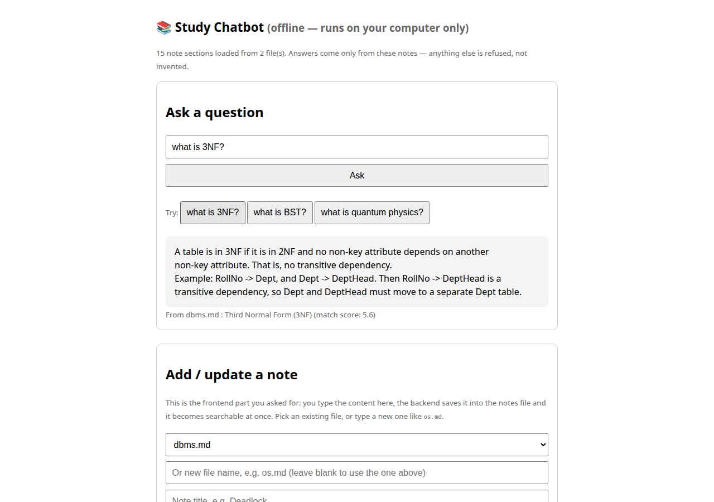
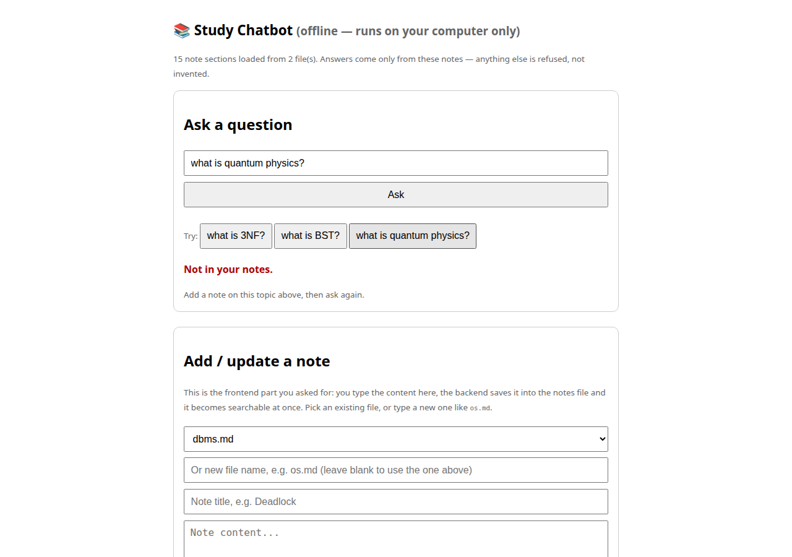
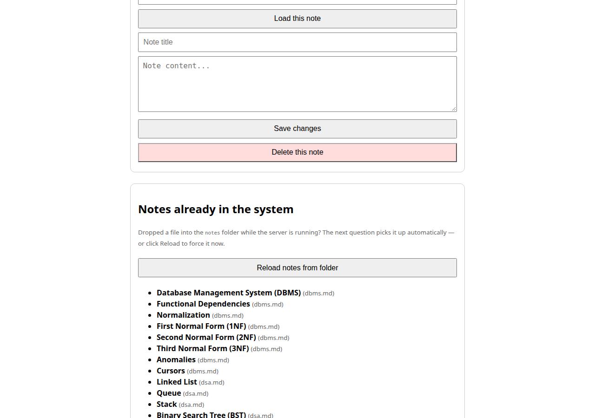

# Grounded Study Chatbot

## Web version (frontend + backend, fully offline)

```bash
python server.py
```

Then open http://localhost:8000 in your browser — no internet needed,
it only talks to your own computer.

- **Frontend** (`web/index.html`): ask a question, and add/update notes
  (pick a file, type a title and content, click Save note).
- **Backend** (`server.py`, Python standard library only): saves the note
  into `notes/`, reloads its search index at once, and does all the
  searching. A note you just added is searchable immediately.

## Screenshots (running)

The web version running on `http://localhost:8000`:


*Home page — 15 note sections loaded from 2 files, with suggested questions.*


*"what is 3NF?" answered from dbms.md (match score 5.6).*


*"what is quantum physics?" is refused with "Not in your notes" — it is not in the notes, so no answer is invented.*


*Notes already in the system, with reload, edit and delete.*

## Terminal version

A chatbot that answers **only from your own notes** — the opposite of a
hallucinator. If a question isn't covered by your notes, it says
"Not in your notes" instead of inventing an answer.

## Run it

```bash
cd study-chatbot
python3 chatbot.py
```

Or ask one question directly:

```bash
python3 chatbot.py "what is 3NF?"
python3 chatbot.py "what is a binary search tree?"
python3 chatbot.py "what is quantum physics?"
```

The last one should be refused — quantum physics is not in the sample notes.

## Add your own notes

Drop `.txt` or `.md` files into `notes/`. Use a heading (`# Topic`) per
section — each heading becomes one searchable chunk. No code changes needed,
and no API key, internet, or extra libraries: it uses Python's standard
library only.

## How it stays grounded

1. Notes are split into chunks, one per heading.
2. Your question is matched against chunks by IDF-weighted word overlap —
   rare topic words (like "normalization") count more than common words.
3. A chunk only wins if its score clears a threshold. Below it, the bot
   refuses instead of guessing.
4. The answer printed is the note text itself, verbatim, with its source
   file and heading — so you can check it.

## Make it smarter later (optional)

- Split notes into smaller chunks for longer files.
- Add synonyms (e.g. "BST" = "binary search tree").
- Swap the keyword scorer for embeddings — but keep the same rule:
  below-threshold = "Not in your notes", never a made-up answer.
